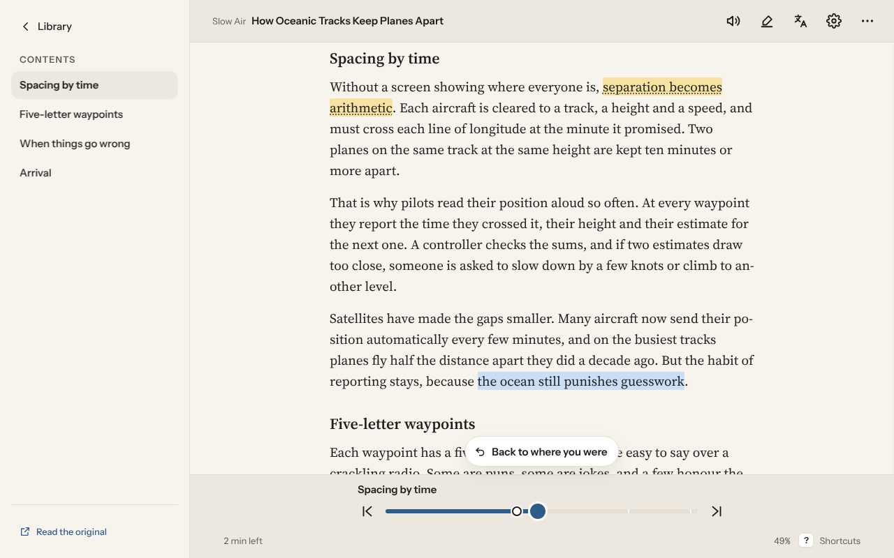
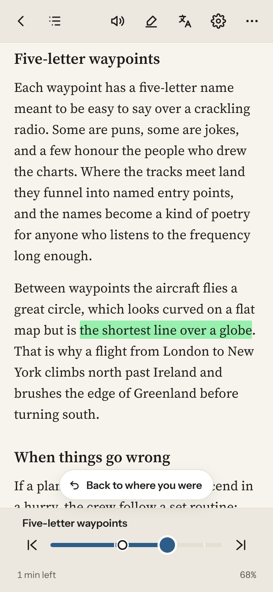
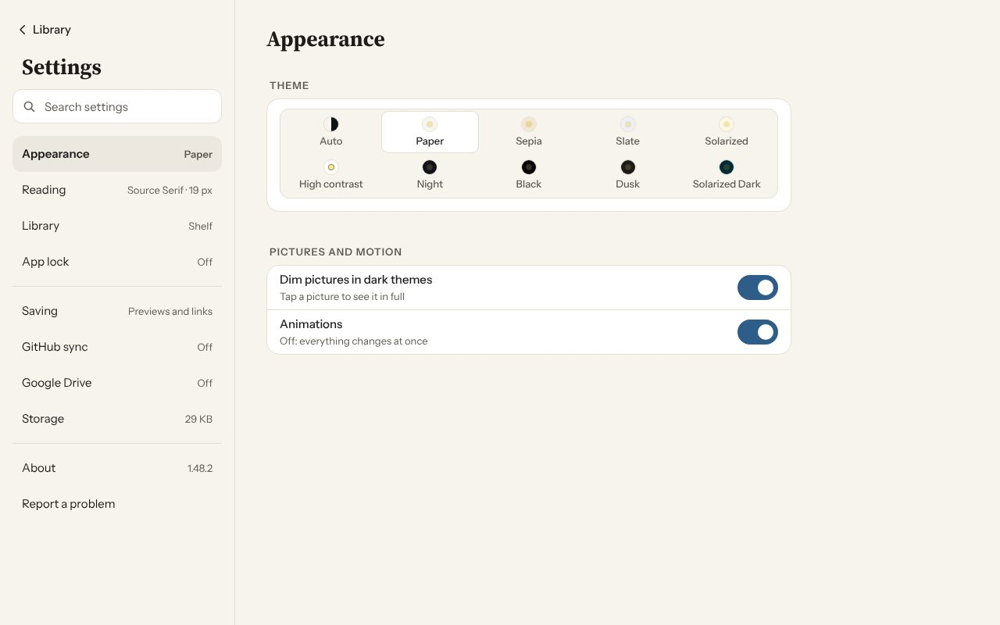
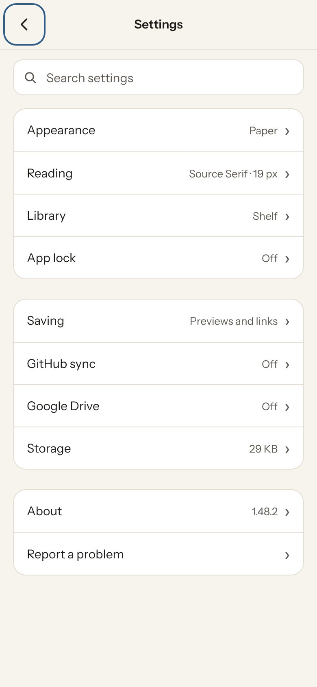

# Waypage

Save a web page to your phone and read it with no connection: on a plane,
in a tunnel, anywhere. The text is kept whole, pictures keep a small
preview with a link to the full size, and videos keep a thumbnail that
plays when you're back online. Every clip links back to the original.

Plain HTML, CSS and JS with no build step and no dependencies. The same
files run in a browser (the web copy on GitHub Pages) and, wrapped by
[Capacitor](https://capacitorjs.com), as the Android and iOS apps.

Each section below shows the computer (left) and the phone (right).

## Contents

- [Library](#library)
- [Sidebar](#sidebar)
- [Collections and files](#collections-and-files)
- [Saving](#saving)
- [Reader](#reader)
- [Text and themes](#text-and-themes)
- [Skim](#skim)
- [Highlights, Translate and Look up](#highlights-translate-and-look-up)
- [Narrate](#narrate)
- [Feeds](#feeds)
- [Newsletters](#newsletters)
- [Stats](#stats)
- [Sync and backup](#sync-and-backup)
- [Settings and the app](#settings-and-the-app)
- [Privacy and security](#privacy-and-security)
- [Run it](#run-it)
- [Working on Waypage](#working-on-waypage)

## Library

 

- Continue reading at the top, then Collections, then Clips.
- Shelf, list or grid layouts, site icons and collection covers.
- Filter by unread, finished or a tag; sort by saved, read, length or site.
- Search titles, tags and the full text of every clip.
- Favourites, tags, and a star on a clip's picture.
- Pick several clips to tag, move, mark read, export or delete together; hold or right-click for a clip's menu.
- Edit clips: find and remove or replace words across many clips.
- Import from Pocket, Instapaper, Omnivore, Raindrop and Wallabag.

## Sidebar

 

- Library with favourites, Collections and Clips; Feeds; Newsletters with the latest addresses and unread counts; Highlights; Stats; tags.
- Library, Feeds and Newsletters fold under an arrow inside their row.
- Always there on a wide screen, slides in on a phone.

## Collections and files

 

- Collections are ordered folders: chapters in order, "2 of 4 read", Continue.
- A collection linked to a story's page finds new chapters and shows a "+N" to save them.
- Files: EPUB, PDF, MOBI, AZW3, FB2, CBZ, Markdown, text and HTML, copied in (a clip like any other) or read from where they are. Books keep their own contents.
- PDFs mixing Hebrew or Arabic with English keep each line's words in order.
- Big PDFs are read a piece at a time, never whole in memory.
- A PowerPoint deck (.pptx) is offered as a PDF: Convert redraws the slides, you save the PDF where you like, and it opens like any PDF you picked there.
- Watched folders bring new files into a chosen collection.
- The library can live in app storage, Documents or any folder you pick.

## Saving

 

- Paste, drop or share a link; Ctrl V saves on a computer.
- Save with options: several links at once, a file, article or comic, a collection and tags.
- Wikipedia through its REST API, with its licence line; Readability for everything else.
- Pictures as small previews, full size (capped at 1600 px WebP) or links only, per clip or in Settings; or load pictures only when tapped.
- Videos as a thumbnail and a link.
- Web serials: save next, previous or all along a site's next-chapter links, or a contents page as its chapters. Royal Road, AO3, Scribble Hub, FanFiction.net, Blogger, WEBTOON, Tapas and Wattpad.
- Comics and manga as image chapters, read edge to edge; a page that is a column of pictures is spotted as one, and Save as comic fixes a clip saved as an article. Reading one, Auto-scroll takes Narrate's place, with its own Speed, Go on to the next clip and Keep the screen on.
- Pages built by JavaScript, drawn out of sight first; saving signed in to a site; the Internet Archive's copy when a page is gone.
- Save linked pages from a clip, and Update from the site keeping highlights and your place.
- Saves keep going with the app put away, wait for Wi-Fi if you like, and show in Downloads.
- Before you go offline: saves what's missing, then lists what isn't ready.
- Send to Waypage: a bookmark that saves the page a computer's browser has open.
- Save from email: shared text and .eml files.

## Reader

 

 

- Scroll or Pages, with two pages side by side on wide screens.
- Your place is kept as the paragraph on the middle line, and synced.
- The section being read in the top bar opens Contents; minutes left and percent along the bottom. Tap the text to hide the bars.
- Minutes left by your own reading pace, for the chapter or the whole clip.
- Picture viewer with zoom and swipe; footnotes in a sheet; Find in this clip.
- Previous and Next, and the collection's list, inside the reader.
- Brightness by a swipe on the edge, with Auto.
- Volume buttons turn pages on Android; keyboard shortcuts on a computer.
- Dark PDF pages: with a PDF open, a switch at the foot of Layout recolours its pages to a dark theme.

## Text and themes

 

 

- Themes: Paper, Sepia, Slate, Solarized, High contrast, Night, Black, Dusk and Solarized Dark, or Auto to follow the device.
- Ten reading fonts, four Hebrew ones, and your own.
- Size (or pinch), weight, line and letter spacing, margins, alignment, hyphenation.
- Dim pictures in dark themes.

## Skim

 

- A tap on the bottom row grows the bar into a slider with chapter notches and the chapters before and after.
- Your place waits until you read on; Back to where you were rides above the bar.
- Back to where you were also after Contents, a highlight or an in-page link.
- Works while Narrate is on: the voice goes on from where you skim to.

## Highlights, Translate and Look up

 

- Highlights in five colours, with notes, picked from the selection bar.
- The Highlights place: every highlight, searchable, a colour at a time, Copy all or save as Markdown.
- Translate this clip on the device, under the text or instead of it (ML Kit on Android, Chrome's own translator on a computer); translate selected words.
- Look up words offline in your own StarDict dictionaries.

## Narrate

 

- The device's own voices, offline, with the screen off and lock-screen controls.
- Read from here, a voice per language, speed 0.5x to 3x, footnotes on or off.
- Goes on to the next clip; keeps the screen on if you like; picture in picture; Bluetooth previous and next.
- Sleep timer from the moon on the player, and Sleep 15 min on the lock screen.
- Speech engine picker and Get more voices on Android; Allow mixing with other apps' sound.

## Feeds

 

- Follow a site or feed (RSS, Atom, JSON Feed); posts in one list by day.
- Save a post, save all, or pick several; auto-save a feed's posts.
- Checked with the app closed, with notifications per post or grouped, and quiet feeds.
- Feeds in and out as OPML.
- Swipe sideways to go to the next or previous feed (or address in Newsletters); the chips stay still.

## Newsletters

 

- Make an email address (through Kill the Newsletter) and subscribe with it; emails arrive here and save as clips.
- Several addresses, unread dots, Copy address, and Confirm for subscription emails.

## Stats

 

- Time reading and narrated, words, clips opened, finished and saved, by week, month or year.
- Days in a row and the clips you spent most time on.
- Kept per device and added up through sync and backups; your time in a clip at its end.
- Reading widgets on Android.

## Sync and backup

 

- GitHub sync of clips, places, highlights, feeds, newsletters and stats through your own private repo, with a token for that repo only; each device picks which of them it syncs.
- Resumes after the app closes; on mobile data, sync only places and reading time.
- Google Drive backups, daily to monthly (on Android even with the app closed) or on demand, with pause, resume and delete; pick clips (or links only), feeds and newsletters. Files read from outside stay out of both.
- Back up (with Pause and Stop) and restore one file; export clips and collections as EPUB, HTML, PDF or Markdown.
- Storage: Make room, Make pictures smaller, sizes by collection.

## Settings and the app

 

- Settings in groups: Appearance, Reading, Library, App lock, Saving, GitHub sync, Google Drive, Storage; a search box at the top finds any setting.
- Every setting is a name and one short line; the longer explanation is behind a ? on its heading. Options are drop-downs, themes a grid of swatches.
- About has the version, the changelog, and Credits: what Waypage is built with.
- App lock: passcode, fingerprint or face on Android, erase when forgotten.
- Home screen widgets on Android and iOS: Keep reading, Feeds, Favourites, Collection, Highlight; app icon shortcuts.
- The Android app updates itself and shows What's new; About › Preview builds installs a branch's build before it's released, and puts the release back.
- Report a problem with a local error log.
- Animations switch; motion zooms and moves, never fades.

## Privacy and security

- No server: pages are fetched on the device.
- Saved pages are untrusted and shown in a sandboxed frame with no scripts and a strict CSP; PDFs render in their own locked-down frame.
- Nothing leaves the device unless you turn it on (sync, Drive backups), and Translate runs on the device. The trade-offs are written in NOTES.md.

## Run it

Three ways to use Waypage, same files, same features:

- **In a browser,** nothing to install: open
  <https://danielnoam.github.io/waypage/>. Your clips stay in that
  browser's own storage, offline too (the page is cached, so it opens
  with no connection), and Install or Add to Home Screen makes it look
  like an app. Pictures are kept as links there.
- **On an Android phone,** as the app: download `Waypage.apk` from the
  [latest release](https://github.com/danielnoam/waypage/releases/latest),
  tap it, and allow your browser to install apps the first time. The app
  saves pictures and books to the phone, shares in from other apps, has
  widgets, and updates itself from the releases. iPhone: the same
  release carries an unsigned `Waypage.ipa` for AltStore or SideStore.
- **On your own computer, from the source:** clone the repo, run
  `node server.js` (or double-click `start.cmd` on Windows) and open
  <http://localhost:5173>. That is the web copy served from your disk,
  which is how changes are tried before they are pushed.

## Working on Waypage

[ARCHITECTURE.md](ARCHITECTURE.md) is the map: every file, how the
scripts share one scope, how a link becomes a clip, where clips live,
the sandboxed reader, sync, the phone apps, tests and screenshots.
[CONTRIBUTING.md](CONTRIBUTING.md) is the rulebook: the decisions already
made, the rules for every change, and how versions and releases work.
